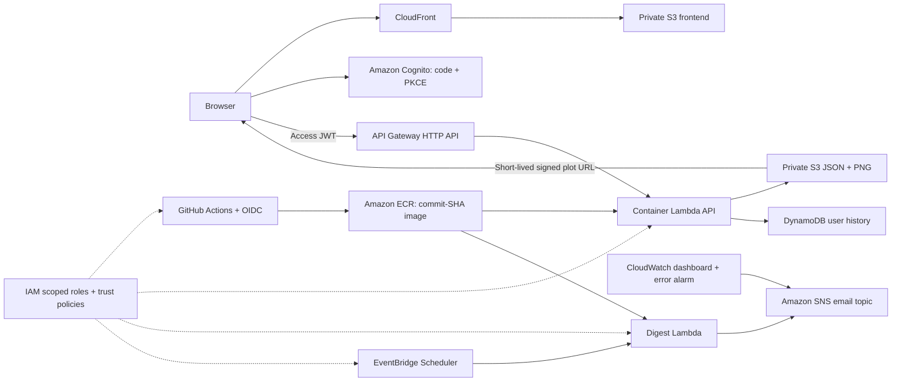

# Cellinguist Cloud

A cloud computing final project for exploring **approved, precomputed** cytokine-response results and keeping a personal query history. Research pipelines, training, live inference, model weights, and existing research outputs are excluded. Course documents stay local and are ignored by Git.

## Implementation status

The platform is deployed on AWS as of 2026-11-10. As of 2026-11-15, this deployment serves three explicitly synthetic, user-approved teaching examples. They are not scientific predictions, and real research artifacts remain excluded. Fresh deployments still default to an empty catalog unless `enable_synthetic_demo = true`.

- Dashboard: https://d3t5bcsvv8n26w.cloudfront.net
- Public API health: https://eg3kg9bak8.execute-api.us-east-1.amazonaws.com/health
- Successful OIDC image build: https://github.com/Wanzi-Xiao/cellinguist-cloud/actions/runs/43752034093
- Successful platform checks: https://github.com/Wanzi-Xiao/cellinguist-cloud/actions/runs/43752034092
- Deployed image source commit: `f62835b1c31fa99d86864bd38adc55e490752506`
- Deployed ECR image digest: `sha256:7c1a85020a48af7cd50e9fd05c15942006808477318dad7cdec0ecde0409a929`

The SNS email subscription is confirmed in AWS as of 2026-11-15. A Terraform-created one-time EventBridge schedule invoked the digest Lambda at 19:30 UTC that day; CloudWatch recorded successful SNS publication of the explicitly labeled course test. The student confirmed receipt of the labeled integration test email. The final course demo remains to be recorded. The weekly digest schedule stays disabled until deliberately enabled.

- Responsive response explorer: sign-in/signup, cell/treatment selection, precomputed plot and JSON summary, saved queries, and reopening historical selections.
- Cognito authorization-code flow with S256 PKCE, random single-use state, a ten-minute callback lifetime, and tab-scoped access tokens. ID/refresh tokens are discarded. Expired sessions require sign-in again; a new sign-in retrieves the same DynamoDB history.
- Public `GET /health`; protected `GET /catalog`, `GET /results`, `POST /history`, `GET /history`. Protected Gateway routes require an access token with `openid` scope.
- Catalog allowlist, byte-bounded inputs, generic server errors, five-minute SigV4 S3 plot URLs, and verified user identity from API Gateway JWT claims.
- User history scoped to `USER#{sub}`; lists at most 50 most recent queries. Client-submitted user IDs are rejected.
- Container-based Python Lambda API and separate operational digest handler. No inference dependencies.
- Terraform defines S3, CloudFront, API Gateway HTTP API, Lambda, ECR, DynamoDB, Cognito, EventBridge Scheduler, SNS, and a CloudWatch dashboard/alarm. IAM is additional to these ten services.
- Terraform uploads all browser assets and generates public `config.js` from resource outputs. Private S3 origins, browser security headers, and disabled CloudFront caching support OAuth callbacks and configuration updates.
- GitHub Actions runs API/frontend/browser checks and Terraform validation. Browser CI is pinned to Ubuntu 22.04 to match the locked Playwright version. A separate workflow builds commit-tagged ECR images with GitHub OIDC using repository variables populated from Terraform outputs (no account-specific fallback values in the workflow). Deployment is a manual reviewed Terraform update.

## Architecture and service justification



| AWS service | Actual role and reason for selection |
|---|---|
| S3 | Stores immutable summaries, PNGs and static assets; simpler than placing blobs in a relational database. The result bucket and frontend origin are private. |
| CloudFront | Provides HTTPS for a restricted S3 origin without operating a permanent web server. |
| API Gateway | Provides HTTP routes, Cognito JWT validation and request throttling instead of a self-managed reverse proxy/auth layer. |
| Lambda | Runs the API and digest from the ECR container on demand; fits this small, irregular request workload without an always-running EC2/ECS service. |
| ECR | Stores commit-tagged application images consumed by Lambda; integrates with IAM/OIDC without external-registry credentials. |
| DynamoDB | Persists user-owned saved queries with partition-key access and no join requirements; simpler than operating a relational database for this access pattern. |
| Cognito | Provides signup, password handling and browser login/logout instead of implementing a password database. |
| EventBridge Scheduler | Stores the weekly cadence and supports an explicit one-time integration check; replaces a permanent cron host. Weekly execution remains disabled by default. A Terraform-created one-time schedule successfully invoked the digest and published a labeled SNS test on 2026-11-15; the temporary schedule is removed after verification. |
| SNS | Delivers operational messages and alarm notifications to the confirmed administrator subscription without custom email delivery code. |
| CloudWatch | Intentionally configured dashboard and error-count alarm provide monitoring beyond default Lambda logs. |
| IAM | Scoped Lambda execution policies and a main-branch-only GitHub OIDC trust policy avoid static AWS keys. IAM is an additional real enabling service; the proposal's ten primary services do not depend on counting it. |

This serverless stack uses public managed HTTPS endpoints with IAM/JWT authorization and private object origins. It does not deploy a custom VPC, NAT gateway, subnet, load balancer or continuously running host. Networking primitives are not included in the service count. The temporary benchmark Lambda has no public route and can read only its dedicated synthetic benchmark prefix; it is removed after measurement and is not a separate counted AWS service.

IAM wildcard rationale: `ecr:GetAuthorizationToken` and `cloudwatch:GetMetricStatistics` require `Resource = "*"` because these actions do not expose resource-level scoping. All ECR upload actions are limited to the named repository, DynamoDB actions to the history table, S3 object reads to the relevant prefix, and SNS publication to the one operations topic. API `s3:ListBucket` is limited to the result bucket so missing objects can return 404. Log writes are limited to the corresponding group streams. These choices are visible in `infra/`; see the [CloudWatch](https://docs.aws.amazon.com/service-authorization/latest/reference/list_amazoncloudwatch.html) and [ECR](https://docs.aws.amazon.com/service-authorization/latest/reference/list_amazonelasticcontainerregistry.html) authorization references.

## Measured gzip evaluation

The API accepts plain JSON or gzip bytes at the same S3 key using `Content-Encoding: gzip`, inflating before returning ordinary API JSON. Wire and inflated JSON are independently capped at 256 KiB; malformed/truncated input is rejected and response bodies are closed. PNG handling is unchanged.

Measurements on 2026-11-15 used deterministic synthetic inputs, gzip level 6, us-east-1 Lambda at 256 MiB, and twelve randomized paired warm trials per fixture (168 measured calls plus fourteen excluded warmups). No model or research dataset was used.

| Synthetic fixture | Plain / gzip bytes | Reduction | Median S3 read+decode ms, plain / gzip |
|---|---:|---:|---:|
| demo_summary | 617 / 333 | 46.0% | 23.703 / 26.771 |
| repetitive_32k | 32768 / 184 | 99.4% | 25.704 / 26.622 |
| mixed_32k | 32768 / 24669 | 24.7% | 25.716 / 25.579 |
| repetitive_128k | 131072 / 424 | 99.7% | 30.252 / 28.618 |
| mixed_128k | 131072 / 98607 | 24.8% | 26.936 / 24.580 |
| repetitive_240k | 245760 / 702 | 99.7% | 26.816 / 27.019 |
| mixed_240k | 245760 / 184869 | 24.8% | 26.066 / 31.190 |

**Decision:** fewer bytes did not yield a consistent latency improvement in this small run. Keep the current sub-KiB summaries plain; retain gzip compatibility for larger inputs that are measured separately. Local inflate medians ranged from about 0.018 to 0.95 ms. The live application passed a mixed gzip/plain test, including signed PNG access and logout/new-login persistence, and the original plain S3 version was restored.

These are warm S3-to-Lambda read+decode measurements, not complete API Gateway/Cognito response latency. Client Lambda Invoke roundtrips were about 0.8 seconds and include SDK/network overhead, but do not return a full summary or include catalog lookup/presigning. Twelve samples are insufficient for dependable p95 or general speed/cost claims. Repetitive/mixed strings are not representative scientific workloads.

Reproduce local timings with `python3 scripts/run_gzip_benchmark.py --output docs/gzip-local.json`. Live measurement requires the optional `enable_gzip_benchmark = true` Terraform resources and an isolated development environment with boto3. The handler has no public API route and reads only `benchmarks/gzip/*`. Run `scripts/run_gzip_benchmark.py --aws --bucket <results_bucket_output>`, then set the flag false and apply to remove temporary compute/IAM/logs. The harness deletes all temporary S3 versions. Keep raw timings and private reports under ignored `docs/`. Production never exposes a benchmark route.

The optional `digest_check_at` UTC variable creates a single operational test schedule in an isolated group. The completed check produced a structured `digest_published` log and SNS message ID; remove the schedule/group with `digest_check_at = ""`. This does not enable the weekly job.

## Presentation and submission

Planned format: recorded video, at most ten minutes, due **December 2, 2026**. The recording/link is pending student work; it has not been submitted. Add the final recording link here or submit the file on Canvas. The official rubric requires a repository, architecture diagram/service justifications, authentication/persistence demonstration, Terraform and an OIDC image-build run, plus challenges/learnings. A three-page optional report draft, five-minute narration plan, teacher-reply draft and rubric checklist are kept locally in `docs/` for student review.

The official group rule is 2–4 students; the original proposal records verbal approval for this individual project. The student must verify that exception and the November 4 signup/roster records. A working deployment does not establish that the registration or Canvas submission was completed.

## Layout

```text
backend/               Lambda API, digest, Dockerfile, unit tests
frontend/              Buildless HTML/CSS/ES modules and frontend unit tests
infra/                 Single Terraform root, pinned provider lockfile
scripts/               Browser regression check, offline setup check, scoped AWS shell setup
.github/workflows/     Platform checks and ECR image delivery
```

`docs/`, `.tools/`, credentials, research data, and Terraform state are ignored. `docs/` retains the proposal and private progress/screenshots on the development server only.

## Verify without AWS or research data

Python 3.12+ and Node 22 are sufficient for the unit tests:

```bash
(cd backend && python3 -m unittest discover -s tests -v)
node --test frontend/tests/*.test.mjs
```

Optional browser regression check:

```bash
npm ci
npx playwright install chromium
npm run test:browser
```

The browser check intercepts **all** requests, including its simulated identity provider and API. It checks desktop/mobile layout, PKCE callback, result display/save/history/revisit, reload/logout, empty catalog, and invalid-state rejection with in-memory contract-test objects. No scientific result is generated and no AWS service is called. Screenshots are stored under ignored `docs/previews/`. On Linux, Chromium may require system libraries; CI uses `playwright install --with-deps chromium`.

To inspect the disconnected dashboard locally:

```bash
python3 -m http.server 8080 --bind 127.0.0.1 --directory frontend
```

Use SSH port forwarding if viewing a remote server. This serves only the frontend directory. The checked-in `config.js` has empty values: login and result actions stay disabled until connected. It does not simulate an authenticated session or supply fake catalog results.

## Synthetic class demo

The user approved adding synthetic examples on 2026-11-15, and the three examples are deployed at the dashboard URL above. `demo/synthetic-v1/` contains three tiny, hand-authored JSON/PNG pairs for two fictional cell types and three fictional treatments (including a combination). Scores are arbitrary illustrative values. The catalog, summary JSON, PNG metadata and image text all identify them as synthetic, and the dashboard shows a persistent warning plus a per-result badge. These assets are safe to publish as course fixtures and are unrelated to existing research directories.

Reproduce the PNG/JSON fixtures with `python3 scripts/build_synthetic_demo.py` (development-only Matplotlib dependency; never installed in Lambda). Check their deployable contract with `python3 -m unittest discover -s scripts/tests -v`. Browser regression tests use these same files with intercepted requests, so screenshots do not pretend to be evidence of AWS deployment.

`enable_synthetic_demo` defaults to false. Set it to true in ignored tfvars to publish the three examples via Terraform; turning it off clears the catalog and removes their current S3 objects. S3 version history remains until teardown. This intentionally replaces the previous bootstrap catalog's `ignore_changes` behavior: the catalog is now managed by Terraform. Do not overwrite non-demo result entries without a separate explicit decision.

Suggested recording: sign in → choose **Demo Cell Alpha / Demo Treatment One** → show the synthetic label, plot and JSON → save → sign out → sign in again → open **Saved queries** → revisit the result. No training or inference is involved.

## Live AWS verification

The deployed platform passed public-health and unauthenticated-rejection checks, CloudFront header checks, two real Cognito authorization-code/PKCE logins, authenticated empty-catalog behavior, user partition isolation, history after reload, and hosted logout. Test-user email was suppressed. Both temporary users and a temporary history probe were removed afterward.

To repeat deliberately on the configured Linux development server (requires project AWS credentials, system Python with `memfd_create`, and installed Playwright/Chromium):

```bash
source scripts/aws_env.sh
CELLINGUIST_LIVE_CHECK=1 npm run test:aws
```

This live check creates two temporary Cognito users and one temporary DynamoDB history probe. It never adds result artifacts or runs a model. Passwords stay in anonymous memory, never CLI arguments or disk; `.tools/live-smoke-cleanup.json` records only resource IDs for recovery if interrupted. Logs/screenshots remain under ignored `docs/` when redirected there.

On 2026-11-15, real AWS checks passed for synthetic labels, signed PNG delivery, unsigned PNG rejection (403), UI saving, two-user isolation, history after reload, and reopening a saved query after logout and a completely new login. All temporary users and their saved records were removed. The final Terraform plan reports no changes.

With the optional synthetic catalog enabled, the live check exercises the real private plot link, unsigned-plot rejection, UI Save query, cross-user isolation, reopening a saved query, and persistence after logout followed by a new Cognito login. With an empty catalog it instead uses a temporary direct-table history probe. Every saved test record in these freshly created test users' partitions is deleted before the users are removed. It never reads unrelated user partitions.

## Personal AWS account setup

The development server has project-local AWS CLI v2 and Terraform in ignored `.tools/bin/`. These binaries are not shipped through Git. A new checkout needs AWS CLI v2 and Terraform installed separately (place/link the CLI at `.tools/bin/aws` to use the helper).

Run these in your own SSH terminal; do not paste passwords, AWS keys, or authorization codes into chat:

```bash
cd /vast/acillo/wax11/cellinguist-cloud
source scripts/aws_env.sh
aws login --profile cellinguist-console --remote
aws sts get-caller-identity
```

Open the link printed by the CLI in your browser and paste the returned code **into that terminal**. The helper creates isolated project profiles and a login-cache directory under ignored `.tools/aws/`, leaving existing `~/.aws` profiles unchanged. The helper itself performs no login or cloud requests. Run `source scripts/aws_env.sh` again in each deployment terminal.

AWS browser login requires a suitable IAM identity and `SignInLocalDevelopmentAccess` permission. Use the intended deployment identity with permissions to provision the listed resources. The `cellinguist` profile uses the CLI as a credential process, so the pinned Terraform provider can consume the newer browser-login session without saving static AWS keys. See [AWS CLI browser login and process-credential documentation](https://docs.aws.amazon.com/cli/latest/userguide/cli-configure-sign-in.html).

`python3 scripts/check_setup.py` checks tools and configuration presence offline; it does not prove credentials are valid. Verify the account with `aws sts get-caller-identity` before any apply. Docker is optional on this server because GitHub Actions builds the image.

## Deployment runbook

No step below runs automatically. AWS resources incur charges while deployed. State is local, ignored, and must be retained securely until teardown.

1. Authenticate and verify the intended account as above. Copy `infra/terraform.tfvars.example` to ignored `infra/terraform.tfvars`; review region/environment and set the administrator notification email if desired. Keep `api_image_uri = ""` and `enable_schedule = false` initially. If the account already has a GitHub OIDC provider, set `github_oidc_provider_arn` to reuse it. Set `github_oidc_subject` to the exact subject issued for this repository/main branch; new GitHub repositories include immutable owner/repository IDs. The example is configured for this repository. See [GitHub immutable-subject documentation](https://github.blog/changelog/2026-04-23-immutable-subject-claims-for-github-actions-oidc-tokens/).
2. Review and apply bootstrap infrastructure:

   ```bash
   cd infra
   terraform init
   terraform fmt -check
   terraform validate
   terraform plan -out=bootstrap.tfplan
   terraform apply bootstrap.tfplan
   terraform output
   ```

   Bootstrap creates the dashboard, Cognito, ECR, storage, monitoring, and supporting services. The private catalog is initialized as `{"version":"v1","entries":[]}`. Both image-based Lambdas, their API routes, and the schedule are omitted until an image exists, so the dashboard cannot reach working API routes yet.
3. Configure GitHub repository Actions **Variables** (not access-key secrets): `AWS_REGION` from your selected region, `AWS_ROLE_ARN` from Terraform `github_role_arn`, and `ECR_REPOSITORY` from Terraform `ecr_repository_url`. The workflow has no account-specific fallbacks and skips image delivery until all three variables exist. Dispatch **Build API image** from `main`, or push a new commit to `main`. Forks need their own variables and matching OIDC trust before image delivery is enabled. ECR tags are immutable: rebuild with a new commit SHA when needed. The OIDC trust policy must exactly match the main-branch subject; it grants image delivery only, not infrastructure administration.
4. Record the successful Actions run URL and exact ECR image digest. Set `api_image_uri` in private tfvars to `repository@sha256:...`, then review a new plan and apply it. Both Lambdas use that image with different handler commands. Terraform generates `config.js` and uploads all browser assets; no manual copying of API URLs is needed. The public frontend bucket remains private behind CloudFront origin access control.
5. Verify `/health`, unauthenticated rejection, Cognito signup/sign-in/logout, access-token authorization, empty catalog behavior, and history isolation with two real accounts. The local tests and mocked browser checks do not replace AWS integration testing.
6. Confirm the SNS email subscription. Test the digest and alarm, inspect the CloudWatch dashboard, and only enable the weekly schedule when desired. The digest reads aggregate metrics, never personal query histories. It defaults to disabled.
7. To publish the approved synthetic class demo, set `enable_synthetic_demo = true`, review a new Terraform plan, and apply it. Terraform uploads six demo artifacts and manages the catalog, publishing the catalog only after its result objects exist. Do not manually replace the managed catalog: later applies restore the selected demo/empty catalog. Add any future approved research catalog through an explicit infrastructure change instead. No research-data processing or model operation is part of setup.
8. Record the course demo and deployment evidence. For teardown, empty both S3 buckets (including versioned objects/delete markers) and delete ECR images before `terraform destroy`. Force deletion is intentionally disabled. Retain state until teardown is confirmed.

## Curated-result contract

Private objects:

```text
results/v1/catalog.json
results/v1/{cell_type}/{condition}/summary.json
results/v1/{cell_type}/{condition}/plot.png
```

Catalog: `{"version":"v1","entries":[{"cellType":"approved-slug","conditionId":"approved-slug"}]}`. Identifiers must match `[a-z0-9][a-z0-9_-]{0,63}`. Summary objects are plain or gzip-encoded JSON, bounded to 256 KiB on the wire and after decompression, and displayed as formatted JSON without interpreting HTML. Plots are PNG images accessed through short-lived signed URLs. Missing summary returns 404. No scientific fixtures, seed artifacts, model weights, or result uploads are included.

The gateway uses HTTP API payload format 2.0, rather than the separate API Gateway REST API product. API Gateway validates token signature, issuer, audience and scope; Lambda reads its verified `sub`. Do not expose a public Lambda Function URL. See [AWS JWT-authorizer guidance](https://docs.aws.amazon.com/apigateway/latest/developerguide/http-api-jwt-authorizer.html). CloudFront uses the documented [CachingDisabled policy](https://docs.aws.amazon.com/AmazonCloudFront/latest/DeveloperGuide/using-managed-cache-policies.html#managed-cache-policy-caching-disabled); CSP restricts connections to the configured Cognito origin and regional API Gateway endpoints (the regional pattern avoids a Terraform dependency cycle).

## Course evidence

Completed: real Terraform bootstrap/application apply, GitHub OIDC ECR push, digest-pinned Lambda deployment, real Cognito/browser/history-isolation checks with two temporary users (removed afterward), successful operational-digest publication to SNS, and a successful CloudWatch alarm action to SNS. A final Terraform plan reports no configuration drift. Detailed plans, logs, and state stay local and ignored.

Still needed:

- Record the now-deployed synthetic demonstration for the course video; real research artifacts are not needed.
- Record the digest/alarm/dashboard demonstration. AWS confirms the email subscription and the student confirmed test delivery; the weekly schedule intentionally remains disabled.
- Recorded demo, exact deployed URLs, and cleanup evidence.

## Submission requirements

Final submission and demo day: **December 2, 2026**. Submit the repository URL and either a recorded demo of at most ten minutes or an in-person presentation. The recording link or presentation choice still needs to be added here. For a private repository, grant instructor `dansc0de` access.

The supplied rubric requires at least nine actively used AWS services, Terraform for every counted service, a successful main-branch OIDC image build and SHA-tagged ECR push, signup/login, persistent user changes across logout/login, an architecture diagram with service justification, and an AI-use disclosure. The sections above describe these components; final portal submission and roster/signup records must be checked by the student. A two-to-three-page written report is optional.

## Validation and AI assistance

On 2026-11-10: 11 backend tests, 12 frontend unit tests, desktop/mobile browser flow checks using intercepted requests, and Terraform validation/format checks passed. Browser testing found and fixed a Window.fetch binding issue that Node unit tests alone did not expose. The AWS platform has since been deployed through Terraform and the production image built through GitHub OIDC. Research data processing and inference have not been performed.

ChatGPT/Codex assisted with the backend, dashboard, Terraform, workflows, tests, and documentation. The student must review design decisions, complete AWS integration validation, and disclose AI assistance in the final submission. The local proposal is a design reference, not authorization to execute research or publish its contents.
